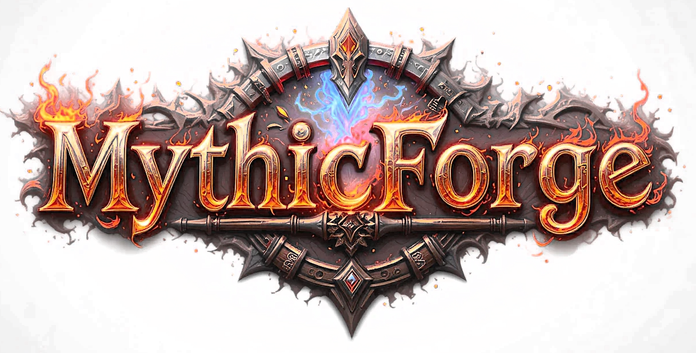
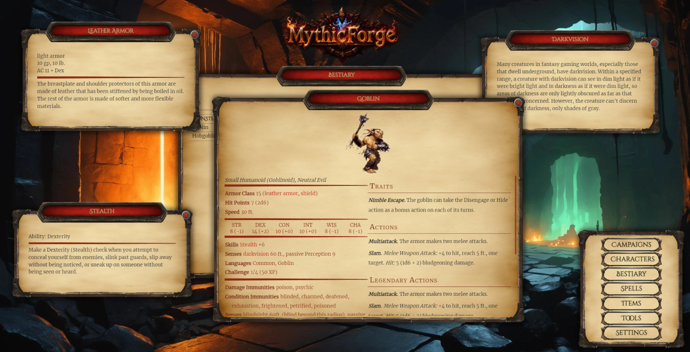

[](https://github.com/armysarge/MythicForge)

[](https://www.buymeacoffee.com/armysarge)

[](https://www.gnu.org/licenses/agpl-3.0)
[](https://www.python.org/downloads/)
[](https://nodejs.org/)
[](https://dsc.gg/mythicforge)
[](https://github.com/armysarge/MythicForge/issues)

<div align="center">
  
</div>

---

<div align="center">
  <strong>🏰 A powerful VTT, digital reference and various other tools powered by AI. MythicForge combines traditional VTT gaming with advanced AI capabilities to enhance your roleplaying experience. 🧙‍♂️</strong>
</div>

---

## VERSION: 0.0.1 EARLY PRE-ALPHA

## ✨ Planned Features

- **D&D 5E digital reference**
  - Spells, items, monsters, and more
  - Quick search and filtering

- **Character Creation & Management**
  - Interactive character builder
  - Automatic stat calculations
  - Character sheet export/import
  - Custom character artwork integration

- **AI-Powered Campaign Management & Tools**
  - Campaign creation and management
  - Session tracking and notes
  - Player character tracking
  - AI Dungeon Master mode
  - Dynamic NPC generation
  - Intelligent encounter scaling
  - Campaign story generation
  - Memory-aware storytelling

- **Flexible AI Integration**
  - OpenAI, Google Gemini support
  - Local AI option for offline use
  - Customizable AI parameters

- **DM Tools**
  - Random encounter generator
  - Custom monster creator
  - Loot table generator
  - Initiative tracker
  - Interactive maps

- **Dice Roller**
  - Customizable dice sets
  - Advanced roll modifiers
  - History and statistics tracking

## 🚀 Getting Started

### Prerequisites

- Python 3.8 or higher
- Node.js 14.x or higher
- SQLite3

### Installation

1. Clone the repository
```bash
git clone https://github.com/armysarge/mythicforge.git
cd mythicforge
```

2. Install Python dependencies
```bash
pip install -r requirements.txt
```

3. Install Node.js dependencies
```bash
npm install
```

4. Configure your environment
```bash
cp .env.example .env
# Edit .env with your API keys and preferences
```

5. Start the application
```bash
npm run start
```

6. To update the application, run
```bash
python scripts/update.py
```

The application will be available at `http://localhost:3000`

## 📚 5e Reference Database & Obsidian Vault

On first boot the server downloads the 5eTools JSON to `public/data/`, then
builds two things from it with `scripts/build_5e_data.py`:

- **`5etools.db`** — 23,594 entries across 84 kinds (monsters, spells, items,
  class features, adventure chapters…) in one `entity` table, with an FTS5
  search index and a `link` table holding the ~114,000 cross-references between
  them, 97% of which resolve to a target.
- **`vault/`** — the same content as one Markdown note per entry at
  `vault/<kind>/<source>/<slug>.md`, with a map-of-content index per kind. Open
  the folder as an Obsidian vault; links between notes are relative Markdown
  links, which Obsidian indexes for graph view and backlinks.

Both are gitignored and regenerable. Rebuild after a 5eTools data update:

```bash
npm run build-data
```

An entry's `id` (`monster/MM/goblin`) is its primary key in `5etools.db`, its
path in `vault/`, and the `reference_id` that campaign records in
`MythicForge.db` use to point at it. One string joins all three.

## 🔌 MCP Server

All 21 operations live in `scripts/forge_tools.py` and are reached three ways — over
MCP, over the web API, and (later) by the in-app AI agent. One implementation, so a
tool added to the registry appears everywhere at once:

```bash
python scripts/forge_tools.py --list
```

The web API is a single dispatch route rather than 21 hand-written ones:
`GET /api/tools` describes the registry, `POST /api/tool/<name>` invokes one with a
JSON object of arguments. The caller's identity comes from their session and is
rejected if it appears in the request body, so nobody can act as another account.

`scripts/mcp_server.py` exposes the same tools to any MCP client (Claude Code,
Claude Desktop, etc.) over stdio:

- **5e reference, read-only** — `search_5e`, `find_5e_by_name`, `get_5e_entity`,
  `backlinks_5e`, `list_5e_kinds`
- **Campaign, read** — `list_campaigns`, `list_characters`, `get_character`,
  `get_inventory`, `list_encounters`, `get_encounter`
- **Campaign, write** — `add_inventory_item`, `remove_inventory_item`,
  `update_hp`, `log_event`, `create_encounter`, `add_combatant`,
  `set_initiative`, `set_conditions`, `advance_turn`, `end_encounter`

Every write is a named tool with fixed, parameterised SQL, and each one verifies that
the character, encounter or campaign it touches belongs to the caller. There is no
arbitrary-SQL tool, so a model cannot invent a statement that empties a campaign. The
reference database is opened read-only.

Copy the `mcpServers` block from [mcp.example.json](mcp.example.json) into your
client's config and set the absolute path. Then, in a session:

> *"Roll initiative — Thorin plus four goblins from the Monster Manual"*
> *"The goblin crits Thorin for 9"*
> *"What's in Thorin's pack, and what does the bag of holding actually do?"*

Run the test suites with:

```bash
npm test
```

## 👥 Accounts

MythicForge is multi-user. The first visit lands on `/login`, where you can register;
**the first account created becomes the admin**. Everything else in the app requires a
session, and characters, campaigns and encounters are scoped to their owner.

Passwords are salted scrypt via Node's built-in `crypto` — nothing is stored in plain
text, and no external hashing dependency is needed.

Because a single API key from `.env` serves every account, **AI features are off by
default** (`users.allow_ai_use` starts at 0). Enable it per account before `/story` and
`/prop` will answer. Registration is open, so leave this off for accounts you do not
recognise.

Optional environment variables:

| Variable | Default | Purpose |
|---|---|---|
| `MYTHICFORGE_PORT` | `3000` | web server port |
| `MYTHICFORGE_PYTHON_PORT` | `4000` | internal Flask port (loopback only) |
| `MYTHICFORGE_DB` | `MythicForge.db` | campaign database path |
| `MYTHICFORGE_SKIP_DOWNLOADS` | — | `true` skips the 5eTools download and build on boot |
| `DEBUG_MODE` | `false` | verbose output from the Python process |

## 🔧 Configuration

### AI Provider Setup

Configure your preferred AI provider in the `.env` file:

```env
AI_PROVIDER=openai  # Options: openai, gemini, local, none
OPENAI_API_KEY=your_key_here
GEMINI_API_KEY=your_key_here
```

<!--### Local AI Setup

For offline AI functionality:
1. Download the required models using `python scripts/download_local_models.py`
2. Enable local AI mode in settings-->

## 📋 Roadmap

> Per-item build plans and the decisions behind them live in [PLAN.md](PLAN.md).

- ✅ Include 5E tools (Thanks to [5eTools](https://5e.tools/))
- ✅ Basic UI/UX Design
- ✅ 5e reference database + Obsidian vault (`npm run build-data`)
- ✅ MCP server (campaign read/write + 5e reference for AI clients)
- ✅ Multi-user accounts, sessions and per-user data isolation
- ✅ Shared tool layer (one implementation behind MCP, REST and the coming AI agent)
- ✅ Server-side 5e querying (filter monsters by CR, spells by level, with paging)
- 🟦 Digital Reference (In Progress)
- 🟦 Dice roller (In Progress)
- ⬛️ DM tools (encounter generator, Initiative tracker, etc.)
- 🟦 Remote AI Integration (OpenAI, Google Gemini, etc) (In Progress)
- ⬛️ Local AI Integration (Local AI Model, requires extra setup)
- ⬛️ Character builder
- ⬛️ Campaign manager
- ⬛️ Run campaign with AI as DM or as player
- ⬛️ AI-powered DM tools
- ⬛️ AI-powered character builder
- ⬛️ AI-powered campaign tools
- ⬛️ Dungeon/Map Generator
- ⬛️ Soundboard for ambient sounds
- ⬛️ Multi-language support
- ⬛️ Mobile companion app
- ⬛️ Customizable character artwork

<!--## 📚 Documentation

For detailed documentation, visit our [Wiki](https://github.com/armysarge/MythicForge/wiki)-->

## 📈 Progress Screenshot



## 🤝 Contributing

Contributions are welcome! Please read our [Contributing Guide](CONTRIBUTING.md) for details on our code of conduct and the process for submitting pull requests.

## 📄 License

This project is licensed under the AGPL License - see the [LICENSE](LICENSE) file for details.

## 🙏 Acknowledgements

- OpenAI and Google for AI capabilities
- The digital reference data was taken from [5eTools](https://5e.tools/).
All data is owned by Wizards of the Coast.
The data is licensed under the Open Gaming License.
- 3d-dice for the dice rolling animation and logic [3d-dice](https://github.com/3d-dice)
- BoxIcons for the icons used in the project [BoxIcons](https://boxicons.com/)
- Jquery for the JavaScript library [Jquery](https://jquery.com/)
- Bootstrap for the CSS framework [Bootstrap](https://getbootstrap.com/)
- Node.js for the JavaScript runtime [Node.js](https://nodejs.org/)
- Other open-source projects that made this possible (see [package.json](package.json), [requirements.txt](requirements.txt))
- The D&D community for inspiration and feedback

## 💬 Support

- Create an [Issue](https://github.com/armysarge/mythicforge/issues)
- Join our [Discord](https://discord.gg/G5W2QZBevz)
- Telegram [Group](https://t.me/+jg68TLcxyl9kYWI8)
- Email: armysarge.ss@gmail.com

## ☕ Buy me a coffee

If you like this project, consider buying me a coffee to keep me motivated!

[](https://buymeacoffee.com/armysarge)
---

Built with ❤️ for the D&D community